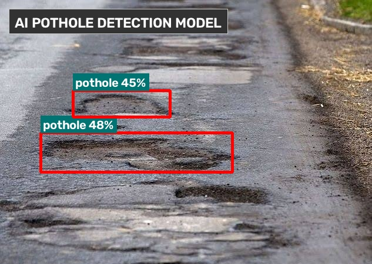
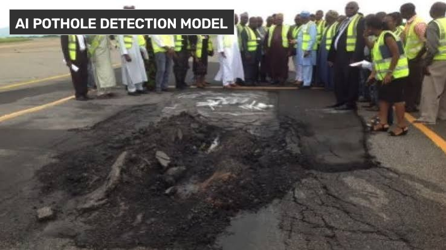
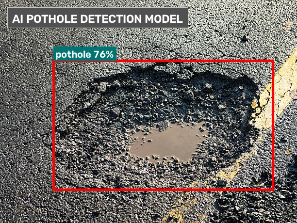
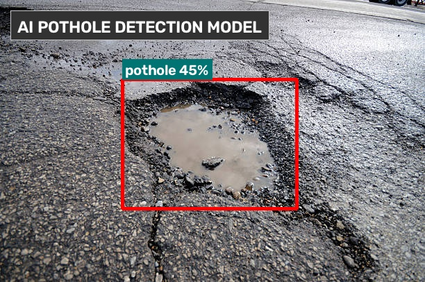
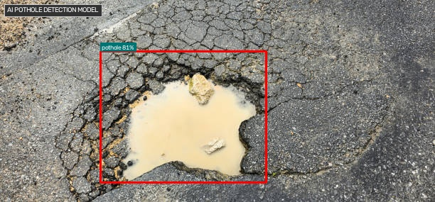

# AI Pothole Detection System – Python

## Project Overview

This project implements an AI-powered pothole and road-defect detection system using YOLO26n. It detects three categories of road defects:

- **Cracks**
- **Patching**
- **Potholes**

The system supports image, video, and real-time detection through a Python desktop interface.

## Features

- Image-based road-defect detection
- Video-based road-defect detection
- Real-time detection using a camera
- ONNX model inference
- PyTorch model inference
- Visual detection results with bounding boxes and confidence scores

## Model Information

- Architecture: YOLO26n
- Framework: Ultralytics
- Model formats: PyTorch (`.pt`) and ONNX (`.onnx`)
- Input resolution: 640 × 640
- ONNX input shape: `[1, 3, 640, 640]`
- ONNX output shape: `[1, 7, 8400]`

### Detection Classes

| Class ID | Class Name |
|---|---|
| 0 | Cracks |
| 1 | Patching |
| 2 | Pothole |

## Technologies Used

- Python
- YOLO26n
- Ultralytics
- OpenCV
- ONNX Runtime
- Tkinter

## Project Structure

```text
Pothole-detection/
│
├── best.pt
├── best.onnx
├── data.yaml
├── export_onnx.py
├── inspect_onnx.py
├── test_best.py
├── test_gen.py
├── test_general.py
├── test_onnx.py
├── test_picker.py
├── test_real.py
├── test_vid.py
├── requirements.txt
├── .gitignore
├── README.md
│
└── test_image/
    ├── 1.jpg
    ├── 2.jpg
    └── ...
```

## Installation

Clone the repository:

```bash
git clone https://github.com/sanihassan-56/AI-Pothole-Detection-Python.git
cd AI-Pothole-Detection-Python
```

Install dependencies:

```bash
pip install -r requirements.txt
```

## Running the Project

Run the desired Python detection script. For example:

```bash
python test_gen.py
```

Other scripts are available for image, video, camera, and ONNX testing.


## Model Files

The repository includes the trained PyTorch and ONNX model files.

- `best.pt`
- `best.onnx`

## Android Deployment

The exported `best.onnx` model was also integrated into a separate Android application using Kotlin and ONNX Runtime.

Android repository:

https://github.com/sanihassan-56/AI-Pothole-Detector-Android

## Prediction Results

The YOLO26n model was evaluated using sample road images and video. The following examples show the detection results produced by the system.

### Image-Based Detection Results









### Latest Detection Result



### Video-Based Detection

The system also supports pothole detection in video files and generates annotated video output.

[Watch the annotated pothole detection video](runs/detect/outputs/predict/output_video.mp4)

## Developer

**Sani Hassan Muhammad**

MSc Artificial Intelligence Project

## License

This project is intended for academic and research purposes. Add an appropriate license before permitting reuse or redistribution.